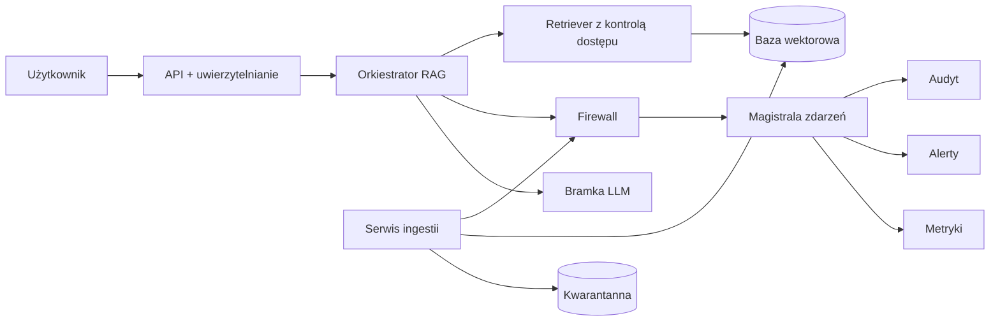
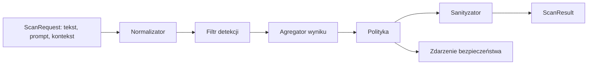
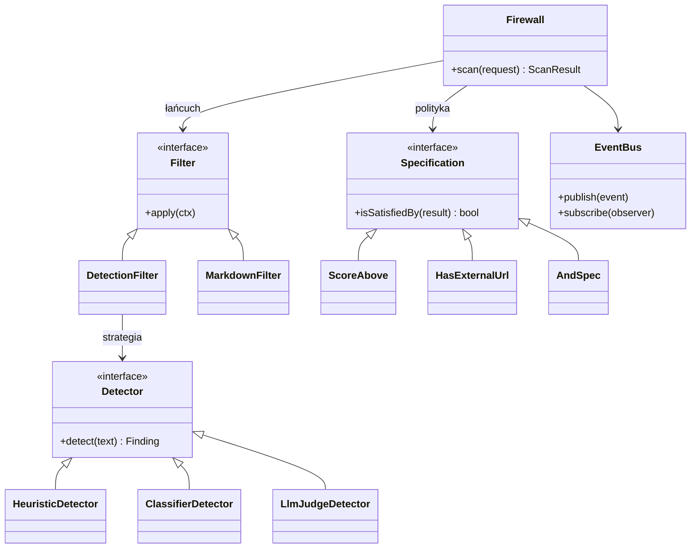
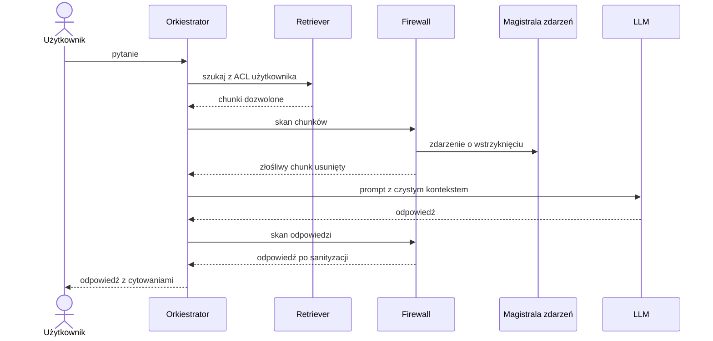
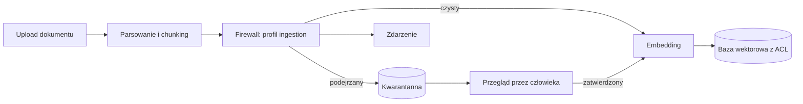
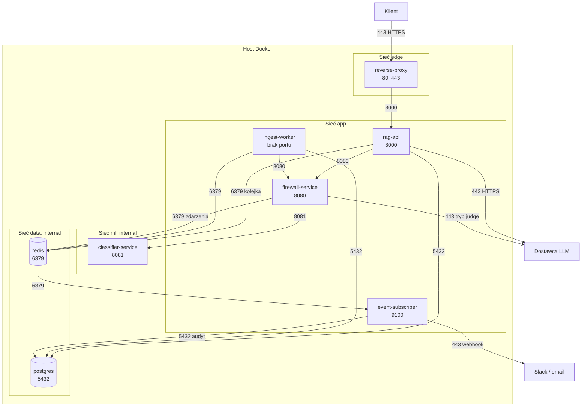
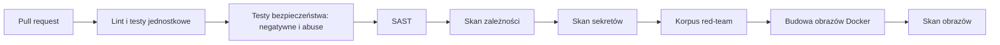

# RAG Firewall: architektura logiczna i fizyczna

## 1. Założenia

**Firewall jest uniwersalny.** To samodzielny komponent, który nie wie nic o RAG. Przyjmuje:

- `text`: dowolny tekst do sprawdzenia (chunk, dokument, odpowiedź modelu),
- `prompt`: pytanie użytkownika (opcjonalnie),
- `context`: kto pyta, skąd pochodzi tekst, jaki profil polityki zastosować.

Zwraca `ScanResult` (decyzja, znaleziska, tekst po sanityzacji). Przepływ jest zawsze ten sam:

**Wykrycie → oflagowanie → zdarzenie.**

To, co firewall robi z tekstem, zależy od **profilu** (zestawu filtrów i polityki), a nie od kodu RAG. Ten sam firewall jest wywoływany w trzech punktach:

| Punkt kontrolny | `kind` | Profil | Co robi |
|---|---|---|---|
| Ingestia dokumentu | `DOCUMENT` | `ingestion` | flaga → kwarantanna |
| Po retrievalu | `CHUNK` | `retrieval` | flaga → usunięcie chunku z kontekstu |
| Po generacji | `OUTPUT` | `output` | usunięcie obrazków/linków spoza allowlisty |

Kontrola dostępu (ACL) **nie jest** częścią firewalla. Działa w retrieverze (filtr przed wyszukiwaniem), bo to kwestia autoryzacji, a nie detekcji.

---

## 2. Architektura logiczna

### 2.1 Widok ogólny



### 2.2 Komponenty

| Komponent | Odpowiedzialność |
|---|---|
| **API + uwierzytelnianie** | Weryfikacja tokenu (JWT), wyciągnięcie `user_id`, `dział`, `role`. Walidacja wejścia, limity zapytań. |
| **Orkiestrator RAG** | Prowadzi przepływ: retrieval → firewall → LLM → firewall → odpowiedź z cytowaniami. Nie zawiera logiki detekcji. |
| **Retriever z ACL** | Zapytanie do bazy wektorowej z filtrem po metadanych ACL (dział, rola) **w samym zapytaniu**, nie po fakcie. |
| **Firewall** | Rdzeń projektu. Pipeline filtrów, detektory, polityka, sanityzacja, publikacja zdarzeń. |
| **Bramka LLM** | Adapter do dostawcy modelu (wymienialny). Tu też mogą działać limity i timeouty. |
| **Serwis ingestii** | Parsowanie, chunking, skan firewallem, embedding, zapis z metadanymi ACL. Podejrzane dokumenty trafiają do kwarantanny. |
| **Kwarantanna** | Dokumenty oflagowane, niewidoczne dla retrievera do czasu przeglądu (zatwierdź / odrzuć). |
| **Magistrala zdarzeń** | Observer: firewall publikuje `SecurityEvent`, subskrybenci reagują niezależnie. |
| **Audyt / Alerty / Metryki** | Subskrybenci zdarzeń: log nieusuwalny, powiadomienie, liczniki do porównania detektorów. |
| **Harness red-team** | Uruchamia korpus ataków przez firewall, liczy detekcję i false-positive dla każdej strategii. |

### 2.3 Wnętrze firewalla (Pipes & Filters / Chain of Responsibility)



- **Normalizator**: usuwa znaki zerowej szerokości, ukryty tekst (HTML/CSS `display:none`, komentarze), normalizuje Unicode. Bez tego heurystyki da się obejść.
- **Filtr detekcji**: wywołuje wybraną strategię detektora (patrz niżej).
- **Agregator**: łączy wyniki wielu detektorów w jeden wynik ryzyka.
- **Polityka**: decyduje, co zrobić (`ALLOW`, `SANITIZE`, `DROP`, `QUARANTINE`, `BLOCK`), używając Specification.
- **Sanityzator**: usuwa niebezpieczne fragmenty, np. obrazki i linki spoza allowlisty w profilu `output`.
- Zdarzenie jest publikowane zawsze, gdy polityka podejmie decyzję inną niż `ALLOW`.

Profile to po prostu różne kolejności i konfiguracje tych samych filtrów:

| Profil | Filtry |
|---|---|
| `ingestion` | Normalizator → Detekcja → Polityka (kwarantanna) |
| `retrieval` | Normalizator → Detekcja → Polityka (drop chunku) |
| `output` | Filtr Markdown (allowlista) → Sanityzator |

### 2.4 Wzorce projektowe (model klas)



| Wzorzec | Gdzie | Uzasadnienie (do ADR) |
|---|---|---|
| **Pipes & Filters / Chain of Responsibility** | Pipeline firewalla | Nowy filtr = nowa klasa, bez zmian w reszcie. Profile to różne konfiguracje łańcucha. |
| **Strategy** | Detektory | Zmiana heurystyki na LLM-as-judge jest zmianą konfiguracji (scenariusz 6). |
| **Specification** | Polityka decyzji | Reguły łączone przez `And/Or/Not`, testowalne osobno. Nowy typ reguły (zmiana z tygodnia 6) to nowa klasa. |
| **Observer** | Magistrala zdarzeń | Firewall nie zna alertów ani audytu. Nowy kanał to nowy subskrybent. |
| **Adapter** (dodatkowo) | Bramka LLM, baza wektorowa | Nowy dostawca lub backend bez zmian w orkiestratorze. |

Odrzucone alternatywy do opisania w ADR: jeden duży `if/else` w detektorze (brak rozszerzalności), dziedziczenie zamiast strategii (kombinatoryczna eksplozja klas), bezpośrednie wywołania alertów z firewalla (silne sprzężenie).

### 2.5 Przepływy

**Scenariusz 1 i 2: zapytanie ze złośliwym chunkiem**



Gdy żaden chunk nie jest dozwolony (scenariusz 4, dział Sales pyta o pensje), orkiestrator nie wywołuje LLM i zwraca „brak informacji". Dzięki temu nic nie wycieka przez streszczenia.

**Scenariusz 5: ingestia**



---

## 3. Architektura fizyczna (Docker)

Cały projekt działa w Dockerze, uruchamiany jednym poleceniem: `docker compose up`. Każdy komponent to osobny kontener. Na hosta wystawione są **tylko porty 80 i 443** (reverse proxy). Pozostałe usługi są dostępne wyłącznie w sieciach Dockera.

### 3.1 Widok wdrożeniowy z portami



### 3.2 Kontenery i porty

| Kontener | Obraz | Port w kontenerze | Port na hoście | Rola |
|---|---|---|---|---|
| `reverse-proxy` | Caddy lub nginx | 80, 443 | **80, 443** | Jedyny publiczny punkt wejścia: TLS, rate limit, nagłówki bezpieczeństwa. Port 80 tylko przekierowuje na 443. |
| `rag-api` | build `./rag` | 8000 | brak | API, orkiestrator, retriever, panel przeglądu kwarantanny (`/admin`). |
| `firewall-service` | build `./firewall` | 8080 | brak | Uniwersalny firewall (HTTP): `POST /scan`, `GET /health`. |
| `classifier-service` | build `./classifier` | 8081 | brak | Lokalny model klasyfikujący injection. Bez dostępu do internetu. |
| `ingest-worker` | build `./ingestion` | brak | brak | Pobiera zadania z kolejki Redis, nie nasłuchuje na żadnym porcie. |
| `event-subscriber` | build `./events` | 9100 | brak | Subskrybent zdarzeń: audyt, alerty, metryki (`/metrics`). |
| `postgres` | `pgvector/pgvector` | 5432 | brak (dev: `127.0.0.1:5432`) | Metadane, ACL, wektory, kwarantanna, zdarzenia. |
| `redis` | `redis` | 6379 | brak (dev: `127.0.0.1:6379`) | Kolejka zadań i magistrala zdarzeń. |

Porty wewnętrzne (8000, 8080, 8081, 9100) są tylko **deklarowane** (`expose`), a nie publikowane. Kontenery rozmawiają ze sobą po nazwach usług, np. `http://firewall-service:8080/scan`.

### 3.3 Sieci Dockera

| Sieć | Typ | Kontenery | Cel |
|---|---|---|---|
| `edge` | bridge | `reverse-proxy`, `rag-api` | Ruch z zewnątrz. Tylko proxy widzi świat. |
| `app` | bridge | `rag-api`, `firewall-service`, `ingest-worker`, `event-subscriber` | Komunikacja między usługami aplikacji. |
| `ml` | **internal** | `firewall-service`, `classifier-service` | Klasyfikator odcięty od internetu. |
| `data` | **internal** | `rag-api`, `ingest-worker`, `event-subscriber`, `firewall-service`, `postgres`, `redis` | Warstwa danych bez dostępu z zewnątrz i bez wyjścia na zewnątrz. |

Zasady:
- Sieć `internal: true` nie ma trasy do internetu ani do hosta.
- `firewall-service` łączy się z Redisem wyłącznie po to, by publikować zdarzenia. Ma osobne dane logowania do Redisa i **nie dostaje** hasła do Postgresa (firewall nie widzi bazy dokumentów).
- Wyjście do internetu mają tylko `rag-api` (dostawca LLM), `firewall-service` (tryb LLM-as-judge) i `event-subscriber` (webhook alertów). Uwaga: sieci bridge domyślnie pozwalają na ruch wychodzący, więc ograniczenie wyjścia do tych trzech kontenerów wymaga dodatkowo reguł egress (np. proxy wyjściowe lub reguły hosta). Warto to opisać w modelu zagrożeń jako ryzyko rezydualne.
- Pliki z uploadu trafiają do wolumenu `uploads` współdzielonego przez `rag-api` i `ingest-worker`.

### 3.4 Szkielet `docker-compose.yml`

```yaml
services:
  reverse-proxy:
    image: caddy:2
    ports: ["80:80", "443:443"]
    networks: [edge]
    depends_on: [rag-api]

  rag-api:
    build: ./rag
    expose: ["8000"]
    networks: [edge, app, data]
    volumes: [uploads:/data/uploads]
    env_file: .env            # poza repozytorium
    depends_on: [firewall-service, postgres, redis]

  firewall-service:
    build: ./firewall
    expose: ["8080"]
    networks: [app, ml, data]
    depends_on: [classifier-service, redis]

  classifier-service:
    build: ./classifier
    expose: ["8081"]
    networks: [ml]

  ingest-worker:
    build: ./ingestion
    networks: [app, data]
    volumes: [uploads:/data/uploads]
    depends_on: [firewall-service, postgres, redis]

  event-subscriber:
    build: ./events
    expose: ["9100"]
    networks: [app, data]
    depends_on: [redis, postgres]

  postgres:
    image: pgvector/pgvector:pg16
    expose: ["5432"]
    networks: [data]
    volumes: [pgdata:/var/lib/postgresql/data]

  redis:
    image: redis:7
    expose: ["6379"]
    networks: [data]

networks:
  edge: {}
  app: {}
  ml:   { internal: true }
  data: { internal: true }

volumes:
  uploads:
  pgdata:
```

Do debugowania lokalnie osobny plik `docker-compose.override.yml` (nie używany na demo) może dodatkowo publikować `127.0.0.1:5432:5432` i `127.0.0.1:6379:6379`. Tylko na `127.0.0.1`, nigdy na `0.0.0.0`.

### 3.5 Zasady bezpieczeństwa kontenerów

- Wszystkie obrazy aplikacji działają jako użytkownik inny niż root, z `read_only: true` tam, gdzie to możliwe.
- Wersje obrazów bazowych są przypięte (bez `latest`).
- Sekrety (klucz LLM, hasła do bazy i Redisa) przez `.env` lub Docker secrets. Plik `.env` jest w `.gitignore`, w repozytorium jest tylko `.env.example`.
- Każdy kontener ma `healthcheck`, a `depends_on` używa `condition: service_healthy`.
- Obrazy są skanowane w CI (patrz 3.7).

### 3.6 Granice zaufania (pod model STRIDE)

| Granica | Zagrożenia (przykłady) |
|---|---|
| Klient → proxy → `rag-api` | **S**poofing (kradzież tokenu), **D**oS (zalew zapytań), **T**ampering (manipulacja parametrami) |
| Dokumenty → ingestia | **T**ampering / poisoning (złośliwy dokument), **E**levation (ukryte instrukcje) |
| `rag-api` → LLM | **I**nformation disclosure (wyciek danych w promptach), indirect injection |
| Wyjście LLM → użytkownik | **I**nformation disclosure (exfiltracja przez Markdown) |
| Retriever → baza | **E**levation of privilege (pominięcie ACL), **I**nformation disclosure |
| Zdarzenia → audyt | **R**epudiation (brak śladu zdarzeń) |

### 3.7 CI/CD i bezpieczeństwo



Przykładowe narzędzia: Semgrep lub CodeQL (SAST), pip-audit / npm audit / Dependabot (zależności), gitleaks (sekrety), Trivy (obrazy Docker). Sekrety wyłącznie ze zmiennych środowiskowych lub menedżera sekretów. Brak sekretów w repozytorium.

---

## 4. Mapowanie scenariuszy

| Scenariusz | Komponenty | Mechanizm |
|---|---|---|
| 1. Happy path | API, Retriever (ACL), LLM, Firewall (`output`) | ACL w zapytaniu, cytowania z metadanych chunków |
| 2. Indirect injection | Firewall (`retrieval`), Event bus | Detektor flaguje, polityka usuwa chunk, zdarzenie |
| 3. Exfiltracja Markdown | Firewall (`output`) | Filtr Markdown z allowlistą domen |
| 4. Kontrola dostępu | Retriever | Filtr ACL przed wyszukiwaniem, brak wyników = brak wywołania LLM |
| 5. Zatruty dokument | Ingestia, Firewall (`ingestion`), Kwarantanna | Flaga przy ingestii, dokument niewidoczny do przeglądu |
| 6. Zmiana strategii | Konfiguracja, Harness red-team | Zmiana `detector: heuristic` na `llm_judge`, porównanie metryk |

### Mapowanie na OWASP Top 10 for LLM Applications

| Ryzyko | Zabezpieczenie |
|---|---|
| LLM01 Prompt Injection | Detektory, normalizator, usuwanie chunków |
| LLM02 Sensitive Information Disclosure | ACL w retrieverze, filtr wyjścia |
| LLM04 Data and Model Poisoning | Skan przy ingestii, kwarantanna |
| LLM05 Improper Output Handling | Sanityzacja Markdown, allowlista domen |
| LLM08 Vector and Embedding Weaknesses | Metadane ACL przy każdym wektorze, filtr w zapytaniu |
| LLM10 Unbounded Consumption | Rate limit, limity rozmiaru dokumentu i kontekstu |

(Numeracja według edycji 2025. Warto zweryfikować z aktualną wersją listy.)

---

## 5. Zmiana z tygodnia 6: jak ją wchłonąć

| Możliwa zmiana | Lokalna zmiana |
|---|---|
| Nowy detektor | Nowa klasa `Detector` + wpis w konfiguracji |
| Nowy typ reguły | Nowa klasa `Specification` |
| Nowy kanał alertów | Nowy subskrybent magistrali zdarzeń |
| Nowy dostawca LLM / baza wektorowa | Nowy adapter |
| Nowy punkt kontrolny (np. skan promptu użytkownika) | Nowy profil w konfiguracji firewalla |

Żadna z nich nie wymaga zmian w orkiestratorze RAG.

---

## 6. Proponowana struktura repozytorium

```
/firewall        # rdzeń: filters/, detectors/, policy/, events/
/rag             # api, orchestrator, retriever, llm adapter
/ingestion       # worker, parsery, kwarantanna
/redteam         # korpus ataków, harness, raporty
/tests/security  # testy negatywne i abuse
/docs
  /adr           # decyzje architektoniczne
  threat-model.md
  agents.md      # jak używano agentów
AGENTS.md        # reguły architektury dla agentów
docker-compose.yml
```

Zasada do `AGENTS.md`: `firewall` nie importuje niczego z `rag` ani `ingestion`. Zależność idzie tylko w jedną stronę.

## 7. Lista ADR do napisania

1. Firewall jako uniwersalny komponent z profilami
2. Pipes & Filters / Chain of Responsibility dla pipeline'u
3. Strategy dla detektorów
4. Specification dla polityki decyzji
5. Observer dla zdarzeń bezpieczeństwa
6. ACL jako filtr w zapytaniu do bazy wektorowej, a nie po wyszukiwaniu
7. Kwarantanna zamiast automatycznego odrzucania dokumentów
8. Wybór bazy wektorowej (pgvector vs osobna usługa)